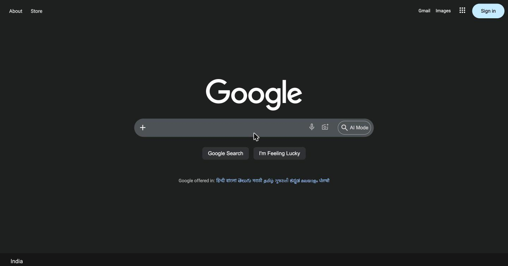

# Google Search — layout clone

A front-end recreation of the Google interface, built with HTML and CSS to practise layout work. No JavaScript, no framework — the whole thing is markup and stylesheet.

**Live demo:** https://google-03gc.onrender.com

> Hosted on Render's free tier, which sleeps when idle — the first load can take up to a minute. After that it is quick.

> A learning project. Not affiliated with, endorsed by, or connected to Google. All Google names and logos belong to their owner; they appear here only because the exercise was to reproduce the layout.

---

## Screenshot



## What it covers

- Centred search layout with the logo, search bar and buttons
- Header and footer links
- Responsive behaviour down to phone widths

Roughly 166 lines of HTML and 468 of CSS.

## Run it

```bash
git clone https://github.com/mukeshkumar-1024/Google-clone.git
cd Google-clone
open index.html        # or just double-click the file
```


## License

The HTML and CSS here are MIT licensed — see [LICENSE](LICENSE). The images and logos under `assets/` are not mine and are not covered by that license.

## Author

Mukesh Kumar — [GitHub](https://github.com/mukeshkumar-1024) · [LinkedIn](https://linkedin.com/in/mukesh-choudhary-64a9a4378)
